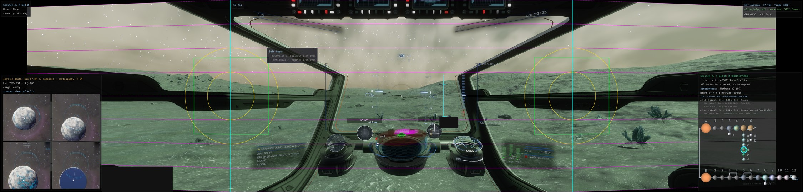

# edwide_screen

A plugin for [edloader](https://github.com/arturbac/edloader) that makes Elite Dangerous look right on three
monitors where the side ones are turned towards you.

The game draws one flat picture over all three monitors. Seen on side monitors set at an angle, the picture's sides
look stretched (at a field of view of about 130 degrees across, things near the outer edges are several times wider
than they should be). edwide_screen takes the finished picture just before it is shown (after the game's upscaling
and its HUD) and lays each side part over its monitor as the eye sees it through that monitor: the middle monitor's
part stays exactly as it was, the sides are squeezed back, and lines that run straight in the world run straight
across the monitor's edge.

- A small element of edloader's list (it passes the game's calls on and hooks only the picture's showing), works
  with or without edworld.
- Everything in `edwide_screen.ini`, read again while the game runs; off until you set it.
- A picture of another size than the one set (the game in a window on the middle monitor, a launcher) is left
  alone, and it comes back on by itself when the size is right again.
- Cost on the graphics card: about 0.1 ms a frame at 9000x2160 (RX 7900 XTX, DXVK).

*`wings_calibrate = 1`: circles, squares and rows across the edges of the middle monitor, to set the angle by
(a screenshot of the whole picture, as the game shows it over the three monitors).*

## Where it is tried

Built and tried only on Linux: Elite Dangerous Odyssey under Proton (DXVK), three 4K monitors with the game's
picture 9000x2160 across them, edloader with EDHM and edworld in its list. It is a plain Windows dll for the game's
DirectX 11, so it should work on Windows the same way, but nobody has tried that yet.

## Use

1. Install edloader, put `edwide_screen.dll` into `edloader\plugins` and a line `edwide_screen.dll` into
   `edloader\edloader.txt` (before EDHM's line).
2. Start the game once, then in `edloader\config\edwide_screen.ini` set the monitors' widths in pixels, your eyes'
   distance and the middle monitor's width in cm, the angle measured, `wings = 1`.
3. `wings_calibrate = 1`, change `wings_angle` in the ini until the circles look round from where you sit (each
   save shows within a second), then `wings_calibrate = 0`.

How to set it up in full: [doc/users.md](doc/users.md). How it works: [doc/developers.md](doc/developers.md).

License: MIT ([LICENSE](LICENSE)).
