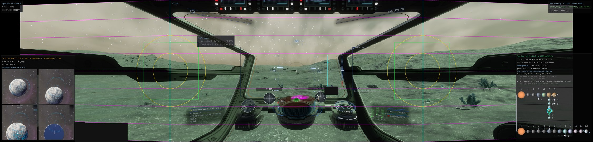

# edwide_screen for players

Tried only on Linux (Proton, DXVK). On Windows it should work the same way, but nobody has tried that yet.

## Install

1. Install edloader first: [edloader's guide, Install](https://github.com/arturbac/edloader/blob/main/doc/users.md#install).
   The `edloader` folder is:
   - on Windows: `C:\Users\<you>\edloader`;
   - on Linux with Steam: `.../steamapps/compatdata/359320/pfx/drive_c/users/steamuser/edloader`.
2. Put `edwide_screen.dll` into `edloader\plugins`.
3. Add a line `edwide_screen.dll` to `edloader\edloader.txt`. If EDHM is in the list, put it before EDHM's line.
   Using it together with other mods: [edloader's guide](https://github.com/arturbac/edloader/blob/main/doc/users.md).
4. Start the game once. This makes `edloader\config\edwide_screen.ini`. Every line in it is a comment, so the
   correction is off.

## Set it up

### 1. Measure

- The angle of the side monitors. For three monitors of width `w`, with the outer edges `e` apart:
  `cos(angle) = (e - w) / (2 w)`.
- The distance from the eyes to the middle monitor, in cm.
- The width of the middle monitor's picture, in cm.

### 2. Write the settings

Open `edwide_screen.ini`. A line without `;` sets a value (`;` and `#` start a comment). Changes apply within a
second of saving.

Example: three 4K monitors 64 cm wide, the outer edges 160 cm apart, the eyes 80 cm away, the game's picture 9000
wide and centred, so 3840 on the middle monitor and 2580 on each side:

```
wings = 1
wings_center_px = 3840
wings_side_px = 2580
wings_angle = 41.4
wings_eye_cm = 80
wings_center_cm = 64
```

### 3. Calibrate the angle by eye

1. Set `wings_calibrate = 1`. On each edge between the middle and a side monitor this draws:
   - two yellow circles and a green square, half on each monitor;
   - magenta rows every eighth of the height;
   - a white line at eye level;
   - the edges in cyan.
2. Look from the seat. When the angle is right, the circles are round, the square is square, and the rows run
   straight across the edges.
3. Change `wings_angle` a degree or two at a time. The log names each new value.
   - The side half of a circle is narrower than the middle half (squeezed): make the angle smaller.
   - The side half is wider (stretched): make the angle larger.
   - No angle makes it both round and straight: check `wings_eye_cm`.
4. Set `wings_calibrate = 0`.



The measured angle is a place to start, not always the end. On the setup of the example (measured 41.4), the shapes
looked right at `wings_angle = 16`.

### Black at the outer corners

The game's picture does not reach that far for this angle. Either:

- set a larger `wings_zoom` (fills it by cutting a little off), or
- set a larger field of view in the game (draws more).

### Optional: the middle monitor true to the eyes

The game's field of view does not change the correction once `wings_eye_cm` is set. For the middle monitor itself to
match the eyes too, set the game's vertical field of view to `2 atan(height_px / 2 / (eye_cm x px_per_cm))`. In the
example that is 25 degrees. A wider one shows more, as it does now.

## All settings

Each setting with its default, its range and whether a change applies at once or at the next start:
[settings.md](settings.md).

## Good to know

- It is off until it is set in `edwide_screen.ini`. Changes in the file apply while the game runs (all but
  `wings_hook`, read when the game starts).
- When the game's picture has another size than the one set (the game in a window on the middle monitor, a
  launcher), edwide_screen leaves it alone. It comes back on by itself when the size is right again.
- With edworld, edworld's `build_info` corner shows a line `edwide_screen <version> wings <angle> deg` (or `wings
  off`): edwide_screen runs, and this is what it does now.
- Cost on the graphics card: about 0.1 ms a frame at 9000x2160 (RX 7900 XTX, DXVK).
- Tried with the game's picture 9000x2160 across three 4K monitors, edloader with EDHM and edworld in its list
  (Elite Dangerous Odyssey).
- The game's HUD and anything a plugin draws into the picture (edworld) are corrected too.
- The mouse is not. On the side monitors the cursor and what it points at part a little. In Elite Dangerous the
  mouse is used on the middle monitor.
- The log is `edloader\logs\edwide_screen.log`. It says when the correction is on, and why it is off, for example:
  "off: the picture is 1920x1080, the settings expect a width of 9000".
- Each game session has its own log. At the next start, the old one moves to the folder
  `edloader\logs\edwide_screen\`.
- Without edloader, the logs are next to the dll in the game's folder. A check of the game's files removes them.
